# Proyecto Final. Diseño e implementación de una red empresarial LAN-WAN con doble pila IPv4/IPv6, VPN IPsec y aplicación de seguimiento en Cisco Packet Tracer

**Asignatura:** Redes y Comunicación de Datos (RCD 262), 2026-2
**Universidad de La Sabana. Facultad de Ingeniería**
**Equipo 7**
**Integrantes:** Juan José Campos Valderrama, Jusselth Habid Chica Rodríguez, Santiago Álvarez Maffiold

---

## Tabla de contenido

1. Metodología
2. Arquitectura de la red
3. Esquema de direccionamiento IPv4 e IPv6
4. Conmutación LAN, VLANs y troncales 802.1Q
5. Enrutamiento e interconexión inter-VLAN
6. Migración IPv6 y VPN IPsec sitio a sitio
7. Filtros de paquetes (ACLs IPv6)
8. Servicios de red (DNS y HTTP/HTTPS)
9. Gestión con SNMP
10. Aplicación Employee Tracker
11. Pruebas y resultados
12. Respuestas a las preguntas guía
13. Retos y soluciones
14. Uso de inteligencia artificial
15. Roles y contribuciones
16. Conclusiones y recomendaciones
17. Referencias

---

## 1. Metodología

El trabajo siguió la guía de diseño estructurado vista en clase. Dividimos el proyecto en cinco fases.

1. **Análisis de requisitos.** Leímos el enunciado y extrajimos las restricciones de direccionamiento, seguridad y servicios. Separamos lo que es IPv6 (las intranets y la DMZ) de lo que es IPv4 (la nube de Internet).
2. **Diseño del direccionamiento.** Asignamos un prefijo /64 por VLAN y por segmento punto a punto, partiendo del bloque asignado al equipo. Documentamos cada subred en la tabla de la sección 3.
3. **Montaje.** Construimos la topología de la Figura 1 en Cisco Packet Tracer con los modelos indicados: router 2811, switch 2960 y switch multicapa 3650.
4. **Configuración de servicios.** Activamos VLANs, troncales, enrutamiento, túnel, ACLs, DNS, HTTP/HTTPS y SNMP en ese orden. Cada servicio se probó antes de pasar al siguiente.
5. **Verificación.** Ejecutamos una batería de pruebas de extremo a extremo. Registramos la evidencia con los comandos `show` y con el modo simulación.

El direccionamiento IPv6 se apoya en el formato de RFC 8200 [1]. La segmentación lógica usa VLANs sobre 802.1Q [2].

---

## 2. Arquitectura de la red

La empresa tiene dos sedes y una zona desmilitarizada.

- **Sede Bogotá.** La administra el router R1_BOG (2811). Los switches de acceso SW1, SW2 y SW3 forman la intranet. El enrutamiento inter-VLAN se hace con router-on-a-stick sobre subinterfaces de R1_BOG.
- **Sede Madrid.** La administran el switch multicapa 3650 (Multilayer Switch0) y el router R2_ESP. El 3650 enruta entre las VLANs de Madrid con interfaces SVI. Los switches SW4 y SW5 dan acceso.
- **DMZ (Bogotá).** Cuelga de R1_BOG a través del switch SW_DMZ. Aloja el servidor Web, el servidor DNS y el Tracker Server.
- **Internet.** Cuatro routers ISP (ISP_BOG, ISP_FL, ISP_NET, ISP_ESP) forman una nube IPv4 que une las dos sedes por enlaces seriales. Dentro de la nube corren OSPFv2 y EIGRP con redistribución entre ambos (ver sección 5).

Las dos intranets usan IPv6. La DMZ usa IPv6. La nube de Internet usa IPv4. La comunicación segura entre sedes viaja por un túnel que lleva IPv6 sobre IPv4 y se cifra con IPsec.

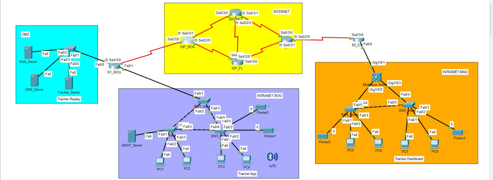

*Figura 1. Topología completa en Cisco Packet Tracer: DMZ, intranet Bogotá, nube de Internet IPv4 e intranet Madrid.*

---

## 3. Esquema de direccionamiento IPv4 e IPv6

Las intranets y la DMZ usan el bloque `2001:1200::/32` del equipo, con un /64 por segmento. La WAN usa el bloque público `86.106.83.0/24` en subredes /30, una por enlace serial. El direccionamiento IPv6 sigue RFC 8200 [1]. Los registros de nombres IPv6 usan registros AAAA según RFC 3596 [3].

### 3.1 Tabla de VLANs y prefijos IPv6

| Sede | VLAN | Nombre | Prefijo IPv6 /64 | Gateway | Dispositivo gateway |
|---|---|---|---|---|---|
| Bogotá | 10 | Internal | 2001:1200:EA17:1::/64 | ::1 | R1_BOG Fa0/1.10 |
| Bogotá | 20 | Guest | 2001:1200:EA17:2::/64 | ::1 | R1_BOG Fa0/1.20 |
| Bogotá | 40 | Printer | 2001:1200:EA17:4::/64 | ::1 | R1_BOG Fa0/1.40 |
| Bogotá | 99 | Native | (sin IP, VLAN nativa de troncales) | — | — |
| DMZ | — | DMZ | 2001:1200:EC17:1::/64 | ::1 | R1_BOG Fa0/0 |
| Madrid | 10 | Internal | 2001:1200:EB27:1::/64 | ::1 | MLSW Vlan10 |
| Madrid | 20 | Guest | 2001:1200:EB27:2::/64 | ::1 | MLSW Vlan20 |
| Madrid | 40 | Printer | 2001:1200:EB27:4::/64 | ::1 | MLSW Vlan40 |
| Madrid | 99 | Native | (sin IP, VLAN nativa de troncales) | — | — |

### 3.2 Enlaces de capa 3 y túnel

| Enlace | Prefijo | Extremo A | Extremo B |
|---|---|---|---|
| MLSW a R2_ESP (L3) | 2001:1200:EB27:FF::/64 | MLSW ::2 | R2_ESP ::1 |
| Túnel R1-R2 (IPv6) | 2001:1200:ED17:FF::/64 | R1_BOG ::1 | R2_ESP ::2 |

### 3.3 Direcciones de servidores (DMZ)

| Servidor | Dirección IPv6 | Rol |
|---|---|---|
| Web_Server | 2001:1200:EC17:1::10 | Portal web (HTTP/HTTPS) |
| DNS_Server | 2001:1200:EC17:1::11 | Resolución de nombres |
| Tracker_Server | 2001:1200:EC17:1::12 | Tracker Relay |

### 3.4 Direccionamiento de hosts

| Host | Sede / VLAN | Dirección IPv6 | DNS |
|---|---|---|---|
| PC1 | BOG Internal | 2001:1200:EA17:1::100 | ::11 EC17 |
| PC4 | BOG Internal | 2001:1200:EA17:1::101 | ::11 EC17 |
| PC2 | BOG Guest | 2001:1200:EA17:2::10 | ::11 EC17 |
| PC3 | BOG Guest | 2001:1200:EA17:2::11 | ::11 EC17 |
| PC5 | MAD Internal | 2001:1200:EB27:1::10 | ::11 EC17 |
| PC7 | MAD Internal | 2001:1200:EB27:1::11 | ::11 EC17 |
| PC6 | MAD Guest | 2001:1200:EB27:2::10 | ::11 EC17 |
| PC8 | MAD Guest | 2001:1200:EB27:2::11 | ::11 EC17 |

### 3.5 WAN IPv4

Cada enlace serial usa una subred /30 dentro de `86.106.83.0/24`. Una /30 deja exactamente dos direcciones utilizables, las que necesita un enlace punto a punto. Los extremos relevantes para el túnel son R1_BOG Serial0/3/0 (86.106.83.1) y R2_ESP Serial0/3/0 (86.106.83.26).

### 3.6 Red de gestión IPv4 (SNMP) en Madrid

El MIB Browser de Packet Tracer no gestiona agentes por IPv6, así que agregamos una red de gestión IPv4 en doble pila sobre las VLANs de Madrid. Esta red solo transporta tráfico de gestión. Los usuarios siguen trabajando en IPv6.

| Equipo | Interfaz | Dirección IPv4 | Gateway | Rol |
|---|---|---|---|---|
| Multilayer Switch0 | Vlan10 | 192.168.10.1/24 | — | Gateway de gestión, internos |
| Multilayer Switch0 | Vlan20 | 192.168.20.1/24 | — | Gateway de gestión, invitados (ACL SNMP-GUEST-MAD) |
| SW4_Intranet | Vlan10 | 192.168.10.2/24 | 192.168.10.1 | Agente SNMP gestionado |
| PC5 | Fa0 | 192.168.10.10/24 | 192.168.10.1 | Estación de gestión (interno) |
| PC6 | Fa0 | 192.168.20.10/24 | 192.168.20.1 | Invitado, sin permiso SNMP |

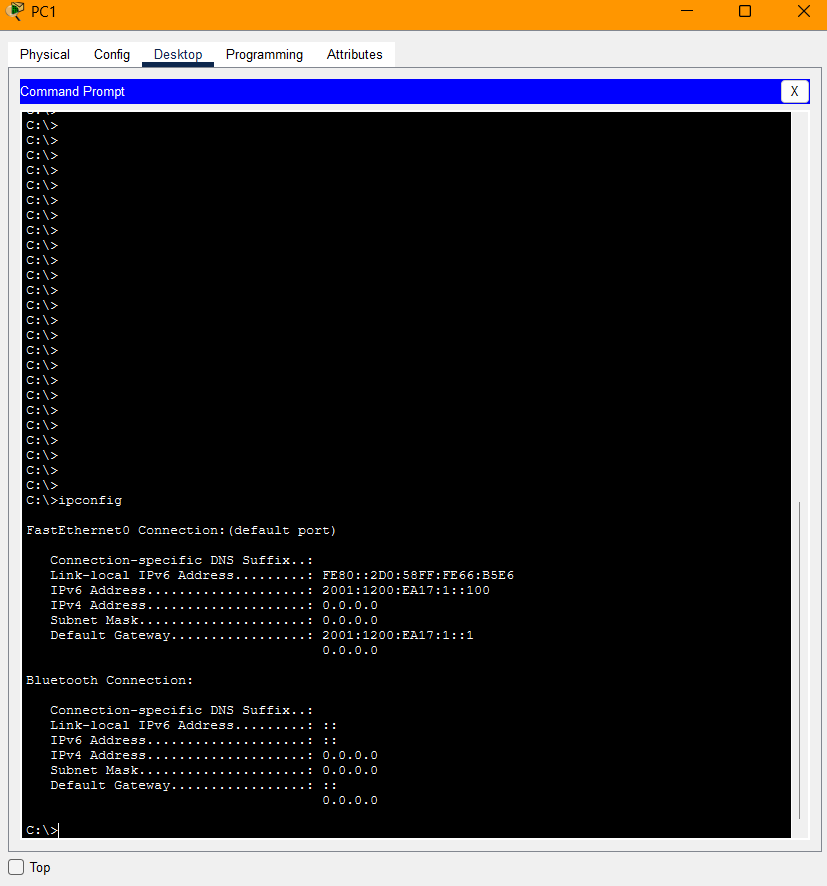

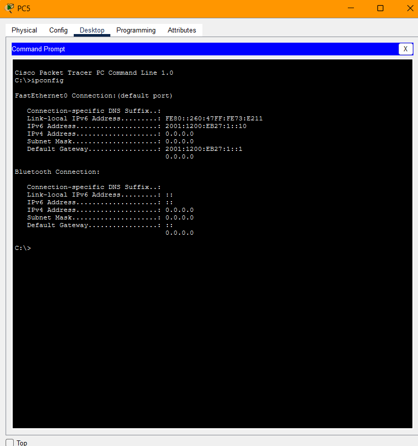

*Figura 2. Salida de ipconfig en PC1 (Bogotá) y PC5 (Madrid) con la IPv6 estática y el gateway.*

---

## 4. Conmutación LAN, VLANs y troncales 802.1Q

Cada switch de acceso define las VLANs 10, 20, 40 y 99. Los puertos hacia PCs e impresoras son de acceso. Los puertos entre switches y hacia el router o el 3650 son troncales 802.1Q [2] con VLAN nativa 99.

Reglas aplicadas:

- Puertos de PC en su VLAN según el rol del usuario (interno o invitado).
- Impresoras en la VLAN 40.
- Troncales con `switchport mode trunk` y `switchport trunk native vlan 99`.
- VLAN 99 presente en la base de datos de todos los switches.

Durante la auditoría encontramos puertos de PC configurados como troncales y dos PCs en la VLAN equivocada respecto a su dirección. Lo corregimos (ver sección 13).

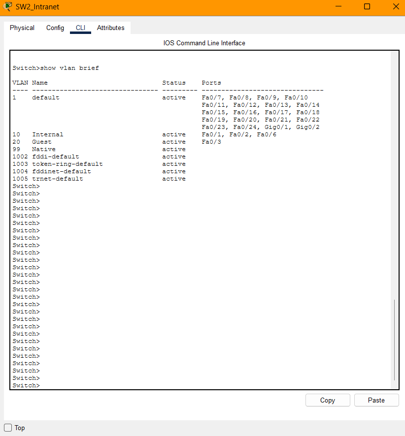

*Figura 3. show vlan brief en SW2_Intranet con las VLANs 10, 20 y 99 y sus puertos de acceso.*

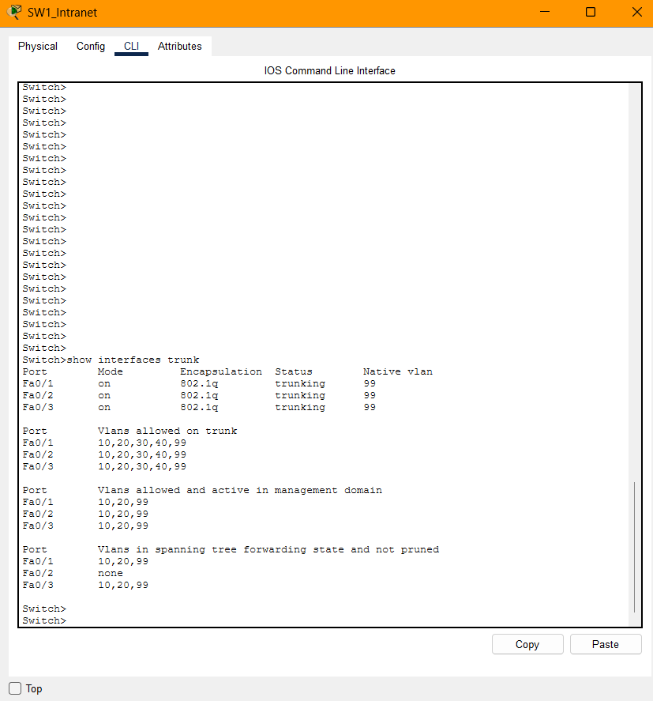

*Figura 4. show interfaces trunk en SW1_Intranet: troncales 802.1Q con VLAN nativa 99.*

Configuración de capa 3 en el 3650 de Madrid. El switch se habilita como router con `ip routing` e `ipv6 unicast-routing`. Cada VLAN tiene una SVI que actúa de gateway.

```
ipv6 unicast-routing
interface Vlan10
 ipv6 address 2001:1200:EB27:1::1/64
interface Vlan20
 ipv6 address 2001:1200:EB27:2::1/64
interface Vlan40
 ipv6 address 2001:1200:EB27:4::1/64
```

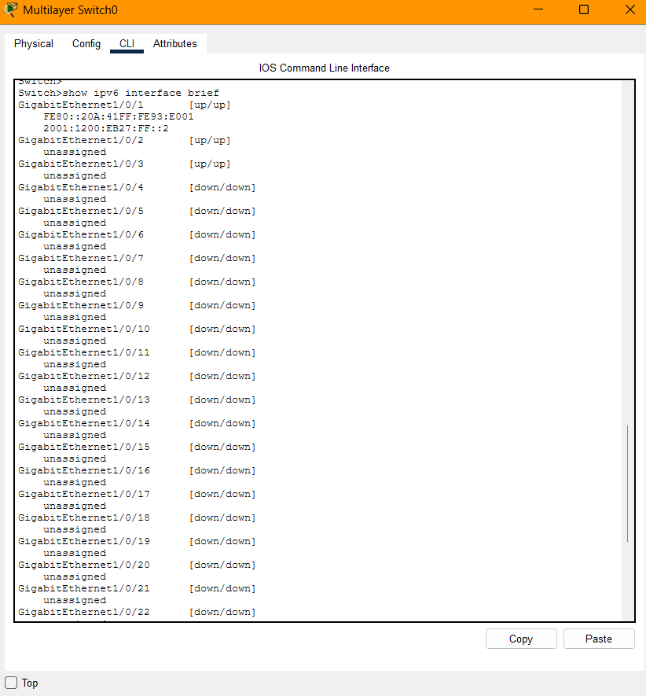

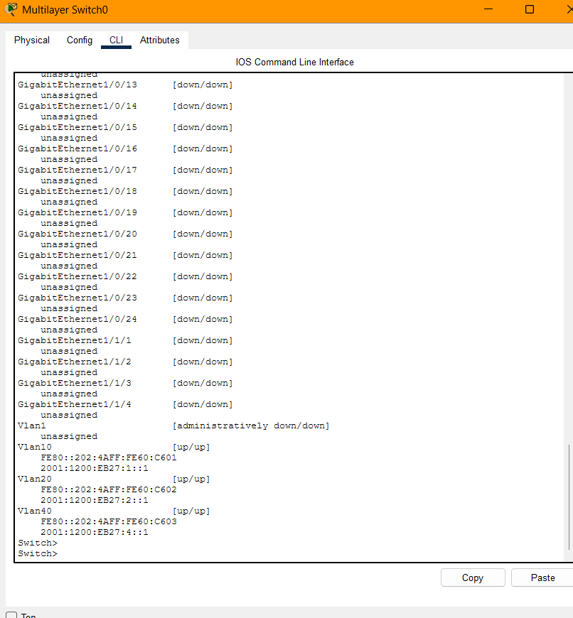

*Figura 5. show ipv6 interface brief en el Multilayer Switch0: enlace L3 Gi1/0/1 y SVIs Vlan10, Vlan20 y Vlan40 en up/up.*

---

## 5. Enrutamiento e interconexión inter-VLAN

El enrutamiento inter-VLAN de Bogotá usa subinterfaces en R1_BOG (router-on-a-stick). Cada subinterfaz etiqueta su VLAN con `encapsulation dot1Q`.

```
interface FastEthernet0/1.10
 encapsulation dot1Q 10
 ipv6 address 2001:1200:EA17:1::1/64
interface FastEthernet0/1.20
 encapsulation dot1Q 20
 ipv6 address 2001:1200:EA17:2::1/64
```

En Madrid el enrutamiento inter-VLAN lo hace el switch 3650 con sus SVIs.

El enrutamiento entre sedes usa dos protocolos dinámicos IPv6 con redistribución. EIGRP para IPv6 (RFC 7868) [17] cubre Bogotá y el túnel. OSPFv3 (RFC 5340) [18] cubre Madrid. R2_ESP actúa de frontera entre ambos y redistribuye las rutas en los dos sentidos.

- **EIGRPv6, sistema autónomo 100.** Activo en R1_BOG (subinterfaces LAN, enlace a la DMZ y Tunnel0) y en R2_ESP (Tunnel0). R1_BOG anuncia las redes de Bogotá y de la DMZ.
- **OSPFv3, área 0.** Activo en R2_ESP (enlace a la MLSW) y en la MLSW (enlace a R2 y SVIs de VLAN). El enlace R2 a MLSW usa tipo de red punto a punto para que la adyacencia llegue a FULL sin elección de DR.
- **Redistribución en R2_ESP.** EIGRP se inyecta en OSPF y OSPF se inyecta en EIGRP. Así R1_BOG aprende las redes de Madrid y la MLSW aprende las de Bogotá y la DMZ.

En la WAN, R1_BOG y R2_ESP mantienen una ruta IPv4 por defecto hacia su ISP. Esa ruta sostiene el destino del túnel.

El núcleo IPv4 del ISP combina dos protocolos dinámicos con redistribución, en línea con lo que pide el enunciado (OSPFv2, EIGRP y redistribución):

- **OSPFv2, área 0**, por el camino ISP_BOG, ISP_FL, ISP_ESP (redes 86.106.83.8/30 y 86.106.83.20/30).
- **EIGRP IPv4, sistema autónomo 7**, por el camino ISP_BOG, ISP_NET, ISP_ESP (redes 86.106.83.0/30, .4/30, .12/30 y .24/30).
- **Redistribución mutua en ISP_BOG e ISP_ESP**, los dos routers que participan en ambos protocolos. ISP_FL aprende las redes EIGRP como externas OSPF (O E2) e ISP_BOG aprende por EIGRP la red de R2_ESP (86.106.83.24/30). Entre las sedes quedan dos caminos posibles.

```
ISP_BOG:
 router eigrp 7
  eigrp router-id 1.1.1.1
  redistribute ospf 1 metric 10000 100 255 1 1500
  network 86.106.83.0 0.0.0.3
  network 86.106.83.4 0.0.0.3
 router ospf 1
  router-id 1.1.1.1
  redistribute eigrp 7 subnets
  network 86.106.83.8 0.0.0.3 area 0

ISP_ESP:
 router eigrp 7
  eigrp router-id 4.4.4.4
  redistribute ospf 1 metric 10000 100 255 1 1500
  network 86.106.83.12 0.0.0.3
  network 86.106.83.24 0.0.0.3
 router ospf 1
  router-id 4.4.4.4
  redistribute eigrp 7 subnets
  network 86.106.83.20 0.0.0.3 area 0
```

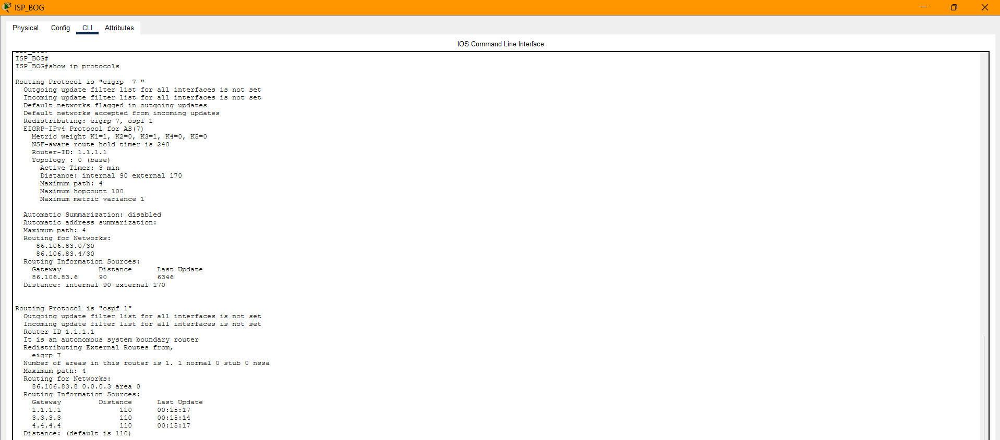

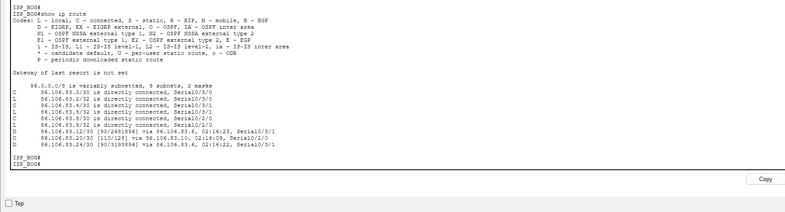

*Figura 6. show ip protocols y show ip route en ISP_BOG: EIGRP AS 7 y OSPF 1 con redistribución mutua, rutas D (86.106.83.12/30 y 86.106.83.24/30) y ruta O (86.106.83.20/30).*

```
R1_BOG:
 ipv6 router eigrp 100
  eigrp router-id 1.1.1.1
 interface Tunnel0
  ipv6 eigrp 100
 (ipv6 eigrp 100 en Fa0/0 y en Fa0/1.10, .20, .30, .40)

R2_ESP:
 ipv6 router eigrp 100
  redistribute ospf 1 metric 1000000 100 255 1 1500
 ipv6 router ospf 1
  router-id 22.22.22.22
  redistribute eigrp 100
 interface FastEthernet0/0
  ipv6 ospf 1 area 0
  ipv6 ospf network point-to-point

MLSW:
 ipv6 router ospf 1
  router-id 33.33.33.33
 (ipv6 ospf 1 area 0 en Gi1/0/1 y en Vlan10, Vlan20, Vlan40)
```

Verificamos la convergencia leyendo las tablas. R1_BOG instala las redes de Madrid como EIGRP externas. La MLSW instala las redes de Bogotá y la DMZ como OSPF externas (OE2). Con el enrutamiento dinámico activo retiramos las rutas estáticas inter-sede.

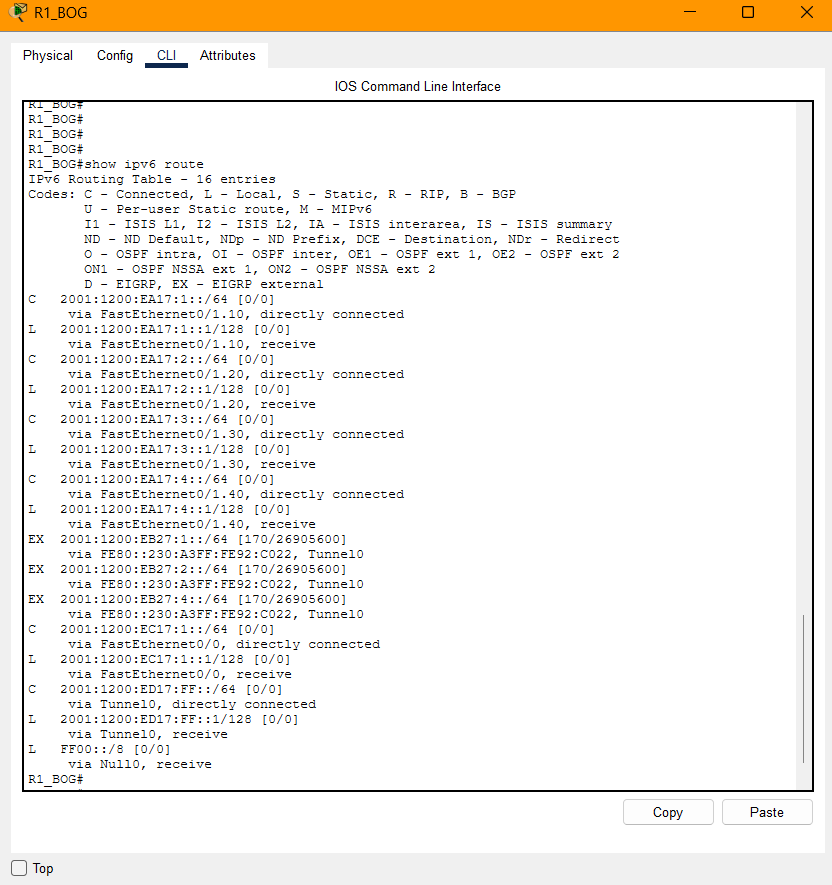

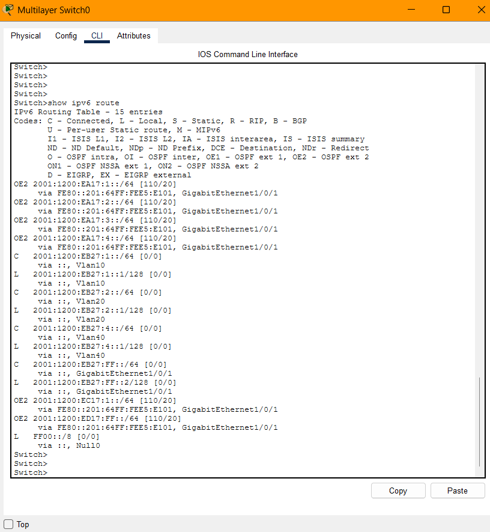

*Figura 7. show ipv6 route en R1_BOG (rutas EX hacia Madrid por Tunnel0) y en el Multilayer Switch0 (rutas OE2 hacia Bogotá y la DMZ).*

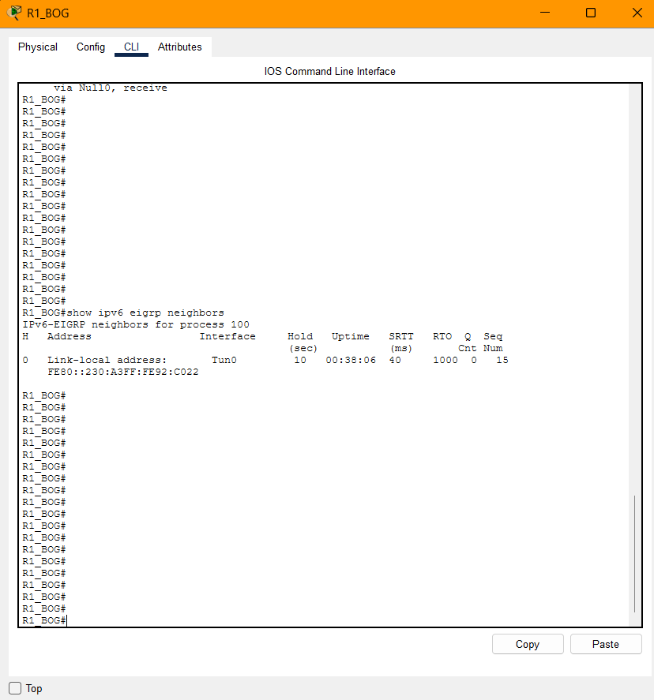

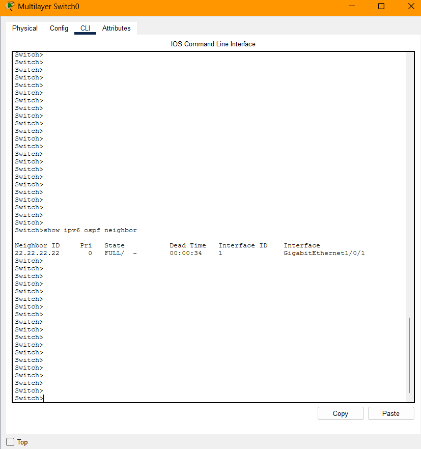

*Figura 8. show ipv6 eigrp neighbors en R1_BOG (vecino por Tun0) y show ipv6 ospf neighbor en el Multilayer Switch0 (vecino 22.22.22.22 en FULL).*

---

## 6. Migración IPv6 y VPN IPsec sitio a sitio

Las intranets usan IPv6 pero deben comunicarse a través de una red que solo habla IPv4. Usamos un túnel configurado 6in4, que encapsula los paquetes IPv6 dentro de paquetes IPv4 según RFC 4213 [4]. El túnel une R1_BOG y R2_ESP.

```
interface Tunnel0
 ipv6 address 2001:1200:ED17:FF::1/64
 tunnel source Serial0/3/0
 tunnel destination 86.106.83.26
 tunnel mode ipv6ip
```

El túnel por sí solo no cifra. Para cumplir el requisito de comunicación segura, protegimos el tráfico con IPsec. La negociación de claves usa IKEv1 (RFC 2409) [5]. El cifrado de carga usa ESP (RFC 4303) [6] dentro de la arquitectura IPsec de RFC 4301 [7].

```
crypto isakmp policy 10
 encr aes 256
 authentication pre-share
 group 2
crypto isakmp key CISCO123 address 86.106.83.26
crypto ipsec transform-set TS-VPN esp-aes esp-sha-hmac
crypto map MAP-VPN 10 ipsec-isakmp
 set peer 86.106.83.26
 set transform-set TS-VPN
 match address 100
access-list 100 permit ip host 86.106.83.1 host 86.106.83.26
```

El `crypto map` se aplica en la interfaz serial. La ACL 100 selecciona el tráfico del túnel (el protocolo 41 entre los dos extremos públicos), de modo que IPsec cifra la encapsulación 6in4.

Verificamos las asociaciones de seguridad con `show crypto ipsec sa`. El estado de las SA entrante y saliente es ACTIVE y los contadores de paquetes cifrados y descifrados aumentan con el tráfico entre sedes.

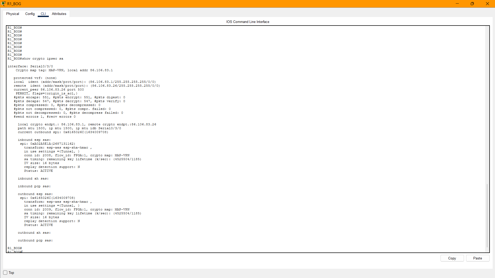

*Figura 9. show crypto ipsec sa en R1_BOG: SA entrante y saliente ACTIVE y contadores #pkts encrypt y #pkts decrypt.*

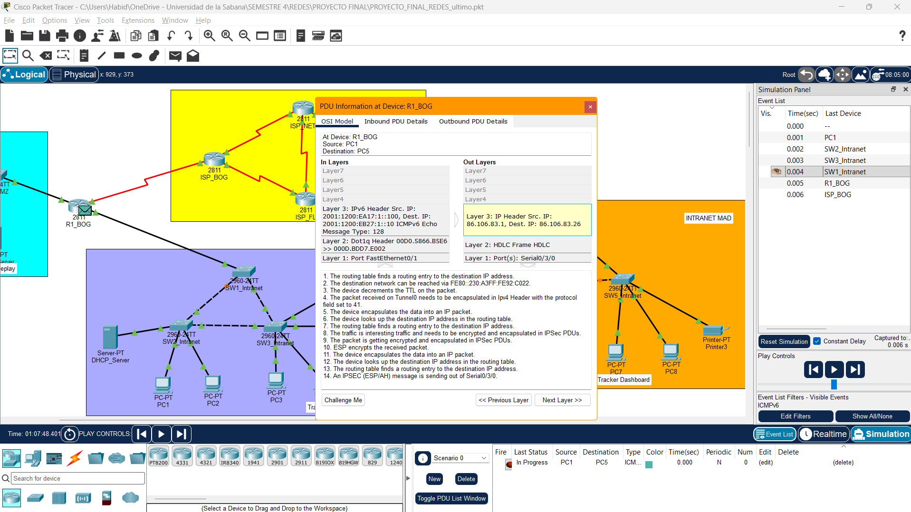

*Figura 10. Modo simulación, ping de PC1 a PC5 en R1_BOG: el paquete IPv6 se encapsula en IPv4 de 86.106.83.1 a 86.106.83.26 (protocolo 41) y se cifra con ESP.*

---

## 7. Filtros de paquetes (ACLs IPv6)

El Departamento de Tecnología pidió controlar el acceso al servidor Web por protocolo. Las reglas son:

- Bogotá interno: accede por HTTPS (443). Se bloquea HTTP (80).
- Bogotá invitado: accede por HTTP (80).
- Madrid invitado: se bloquea HTTPS (443). Accede por HTTP (80).
- Madrid interno: accede al servidor Web solo por HTTPS (443).

Usamos ACLs IPv6 con filtrado por puerto TCP. La ubicación sigue la práctica de colocar la ACL extendida cerca del origen [12]. En Bogotá la ACL entra en las subinterfaces de R1_BOG. En Madrid la ACL entra en las SVIs del 3650.

ACL de Bogotá, aplicada entrante en Fa0/1.10 y Fa0/1.20:

```
ipv6 access-list ACL-SEGURIDAD-BOG
 permit tcp 2001:1200:EA17:1::/64 host 2001:1200:EC17:1::10 eq 443
 deny   tcp 2001:1200:EA17:1::/64 host 2001:1200:EC17:1::10 eq www
 permit tcp 2001:1200:EA17:2::/64 host 2001:1200:EC17:1::10 eq www
 deny   tcp 2001:1200:EA17:2::/64 host 2001:1200:EC17:1::10 eq 443
 permit ipv6 any any
```

ACL de Madrid, aplicada entrante en Vlan10 y Vlan20:

```
ipv6 access-list ACL-SEGURIDAD-MAD
 permit tcp 2001:1200:EB27:1::/64 host 2001:1200:EC17:1::10 eq 443
 deny   tcp 2001:1200:EB27:1::/64 host 2001:1200:EC17:1::10 eq www
 permit tcp 2001:1200:EB27:2::/64 host 2001:1200:EC17:1::10 eq www
 deny   tcp 2001:1200:EB27:2::/64 host 2001:1200:EC17:1::10 eq 443
 permit ipv6 any any
```

Comprobamos el efecto de dos formas. Primero, navegando desde los PCs. Segundo, leyendo los contadores de aciertos de la ACL, que confirman qué regla actuó sobre cada intento.

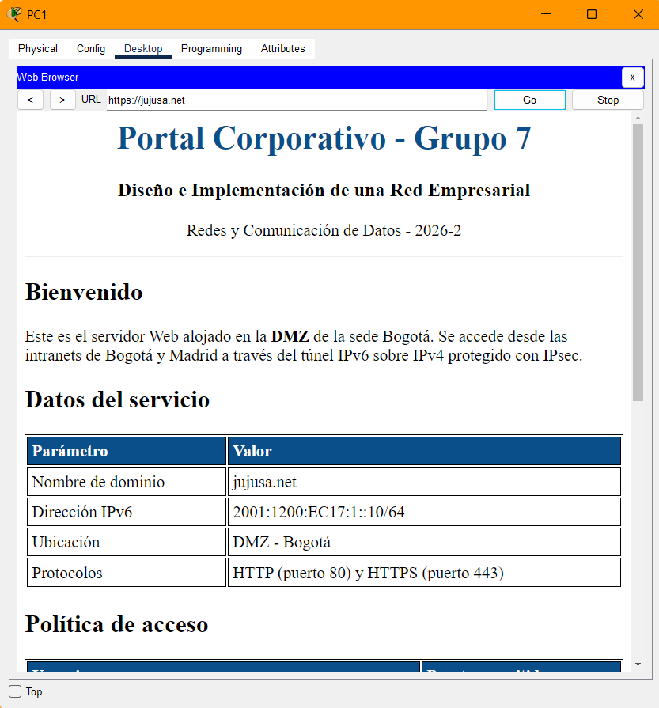

*Figura 11. Navegador de PC1 (interno Bogotá) cargando https://jujusa.net: acceso permitido.*

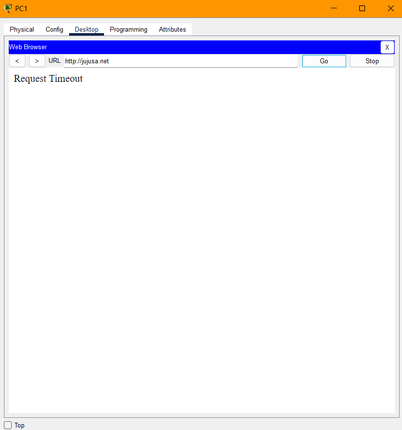

*Figura 12. Navegador de PC1 con http://jujusa.net: Request Timeout, bloqueado por la ACL.*

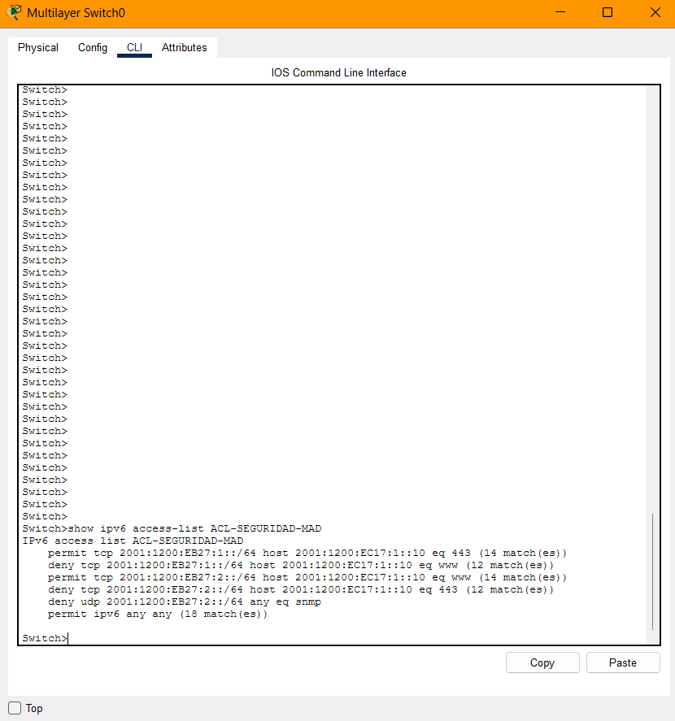

*Figura 13. show ipv6 access-list ACL-SEGURIDAD-MAD con los contadores de aciertos en las reglas permit y deny.*

---

## 8. Servicios de red (DNS y HTTP/HTTPS)

El servidor DNS resuelve el nombre de dominio del equipo. El formato pedido es iniciales de los nombres seguido de `.net`. El dominio es `jujusa.net` y apunta al servidor Web.

```
Registro AAAA:  jujusa.net  ->  2001:1200:EC17:1::10
```

La resolución sigue el modelo de DNS de RFC 1035 [8] con la extensión de registros AAAA para IPv6 de RFC 3596 [3]. Los ocho PCs apuntan al servidor DNS `2001:1200:EC17:1::11`.

El servidor Web aloja un portal personalizado con la información del equipo y la política de acceso. Sirve HTTP y HTTPS.

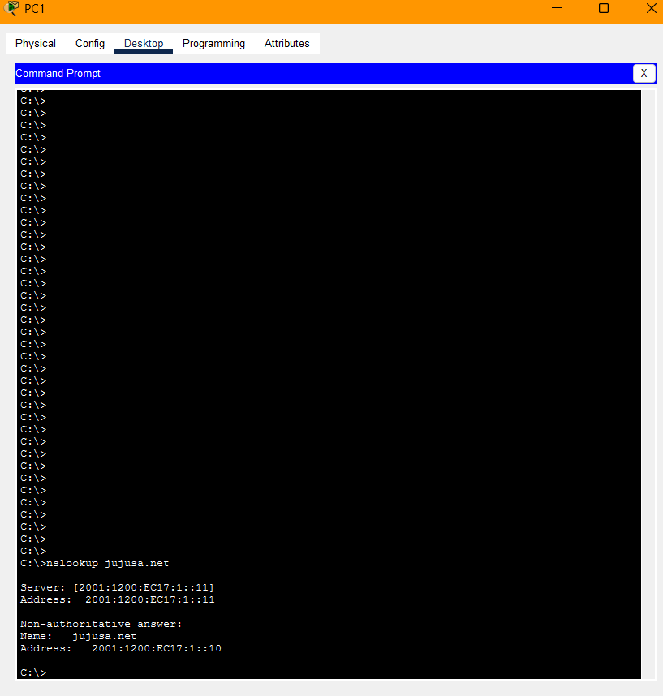

*Figura 14. nslookup jujusa.net desde PC1: el DNS 2001:1200:EC17:1::11 responde 2001:1200:EC17:1::10.*

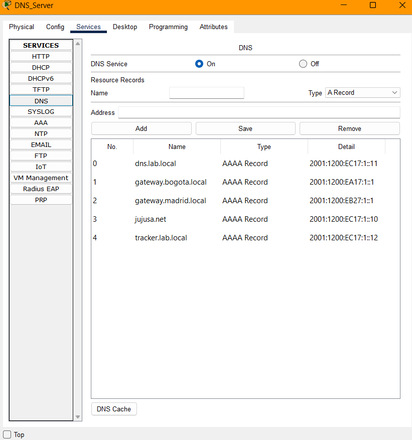

*Figura 15. Servicio DNS del DNS_Server con el registro AAAA de jujusa.net.*


*Figura 16. Portal web personalizado del grupo 7 en el navegador de PC1.*

---

## 9. Gestión con SNMP

La red se gestiona con SNMP. El protocolo sigue RFC 1157 [9] y las operaciones de la versión 2c de RFC 3416 [10]. Configuramos una comunidad de solo lectura y una de lectura y escritura en los routers y switches.

```
snmp-server community adminRO RO
snmp-server community adminRW RW
```

El flujo de gestión usa mensajes get y set sobre una variable MIB, con respuestas get-response del agente. La estación de gestión es PC5 (VLAN interna de Madrid) y el agente gestionado es el switch SW4_Intranet en `192.168.10.2`, a través de la red de gestión IPv4 de la sección 3.6. En el MIB Browser de PC5 se configuran la dirección `192.168.10.2`, el puerto 161, las comunidades `adminRO` y `adminRW` y la versión v2. Con un **get** sobre `sysName` (OID `.1.3.6.1.2.1.1.5.0`) el agente devuelve su nombre. Con un **set** sobre `sysLocation` (tipo OctetString, valor `Madrid-Grupo7`) el agente cambia la variable, y un nuevo get confirma el valor.

Flujo bidireccional observado en el modo simulación con el filtro SNMP:

1. PC5 envía un **GetRequest** (UDP, puerto destino 161) con la comunidad y el OID.
2. SW4 valida la comunidad, lee la variable y responde con un **GetResponse** que lleva el valor.
3. En el set, PC5 envía un **SetRequest** con la comunidad de escritura y el valor nuevo. SW4 actualiza la variable y confirma con su respuesta.

```
SW4_Intranet:
 interface Vlan10
  ip address 192.168.10.2 255.255.255.0
 ip default-gateway 192.168.10.1
 snmp-server community adminRO RO
 snmp-server community adminRW RW
```

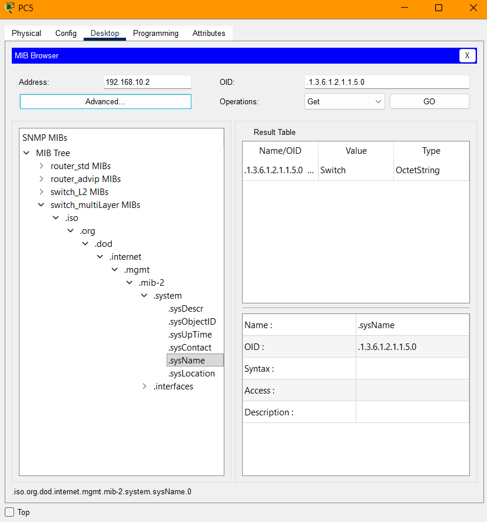

*Figura 17. MIB Browser de PC5 con un get sobre sysName (OID .1.3.6.1.2.1.1.5.0) hacia SW4_Intranet en 192.168.10.2: el agente responde Switch (OctetString).*

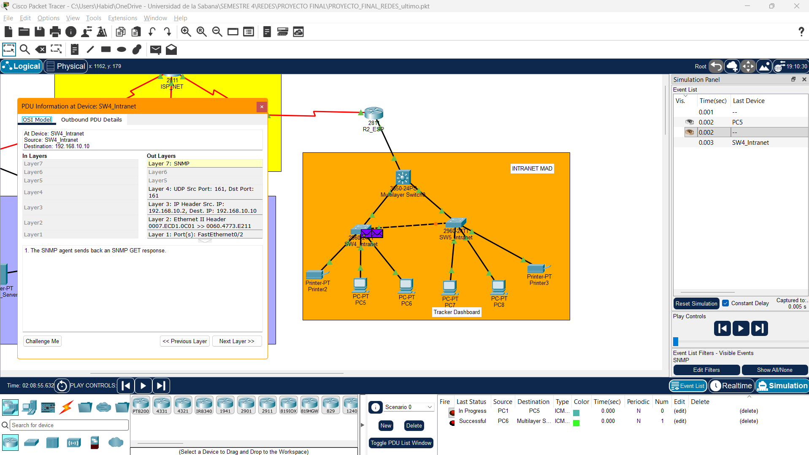

*Figura 18. Modo simulación con el filtro SNMP: SW4_Intranet devuelve el GET response a PC5 (capa 7 SNMP, UDP 161, IPv4 de 192.168.10.2 a 192.168.10.10).*

La gestión queda restringida a los PCs de la VLAN interna. El enunciado pide que solo la red interna administre y que las demás VLANs no usen SNMP. Como Packet Tracer no asocia una ACL IPv6 a la comunidad, aplicamos el control en las ACL de entrada de cada sede. Una regla niega el tráfico SNMP (UDP 161) originado en la VLAN de invitados antes del permiso general. La VLAN interna conserva el acceso.

```
ipv6 access-list ACL-SEGURIDAD-BOG
 ...
 deny udp 2001:1200:EA17:2::/64 any eq snmp
 permit ipv6 any any
```

El mismo criterio se aplica en Madrid con el prefijo de invitados `2001:1200:EB27:2::/64`.

En la red de gestión IPv4 de Madrid la restricción la aplica una ACL extendida entrante en la SVI de invitados del 3650. Un invitado (PC6, `192.168.20.10`) que intenta un get hacia SW4 recibe *timeout*, aunque sí le llega por ping, porque la ACL descarta UDP 161 en Vlan20. PC5, en la VLAN interna, gestiona sin restricción.

```
Multilayer Switch0:
 ip access-list extended SNMP-GUEST-MAD
  deny udp 192.168.20.0 0.0.0.255 any eq snmp
  permit ip any any
 interface Vlan10
  ip address 192.168.10.1 255.255.255.0
 interface Vlan20
  ip address 192.168.20.1 255.255.255.0
  ip access-group SNMP-GUEST-MAD in
```

---

## 10. Aplicación Employee Tracker

La solución Employee Tracker localiza empleados dentro del edificio. Un beacon BLE simulado emite su identificador y una posición estimada (X, Y) en un rango de 0 a 100 metros. El flujo tiene tres etapas y usa sockets TCP sobre la red LAN-WAN.

1. **Tracker App (PC4, Bogotá).** Detecta el beacon por Bluetooth. Por cada lectura genera un paquete con el ID del beacon, la posición (X, Y) y un estado de actividad entre En reposo, En movimiento y Alta actividad. Envía el paquete cada segundo al Tracker Server.
2. **Tracker Relay (Tracker Server, DMZ).** Recibe los paquetes de la Tracker App y los reenvía a la Tracker Dashboard.
3. **Tracker Dashboard (PC7, Madrid).** Muestra la posición y el nivel de actividad en tiempo real. Genera una alerta cuando un empleado permanece en una zona restringida más de 60 segundos o cuando hay un cambio brusco de actividad.

La comunicación entre componentes usa sockets TCP, orientados a conexión y con entrega confiable, según el modelo de transporte descrito en la literatura de redes [13].

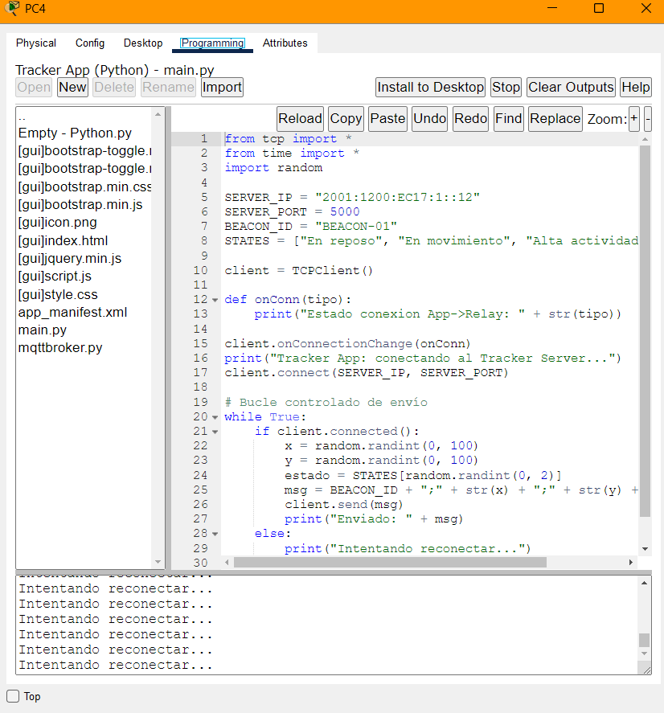

*Figura 19. Pestaña Programming de PC4 con la Tracker App: cliente TCP hacia el Tracker Server (2001:1200:EC17:1::12, puerto 5000) que genera ID, posición X, Y y estado de actividad.*

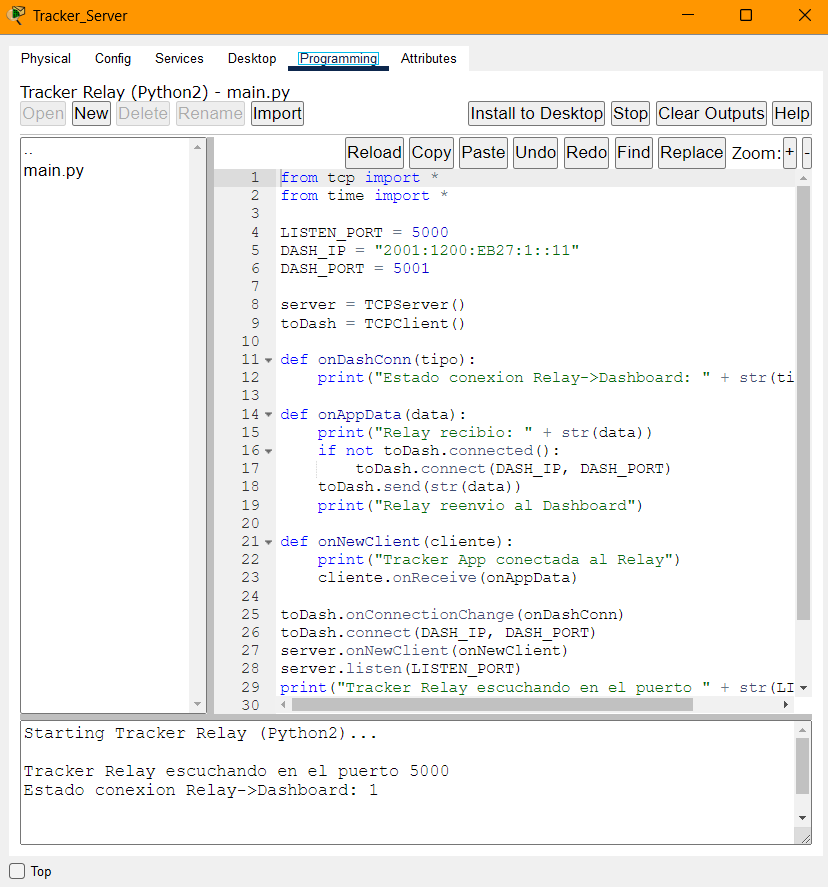

*Figura 20. Pestaña Programming del Tracker_Server con el Tracker Relay escuchando en el puerto 5000 y conectado al Dashboard de PC7 (2001:1200:EB27:1::11, puerto 5001).*

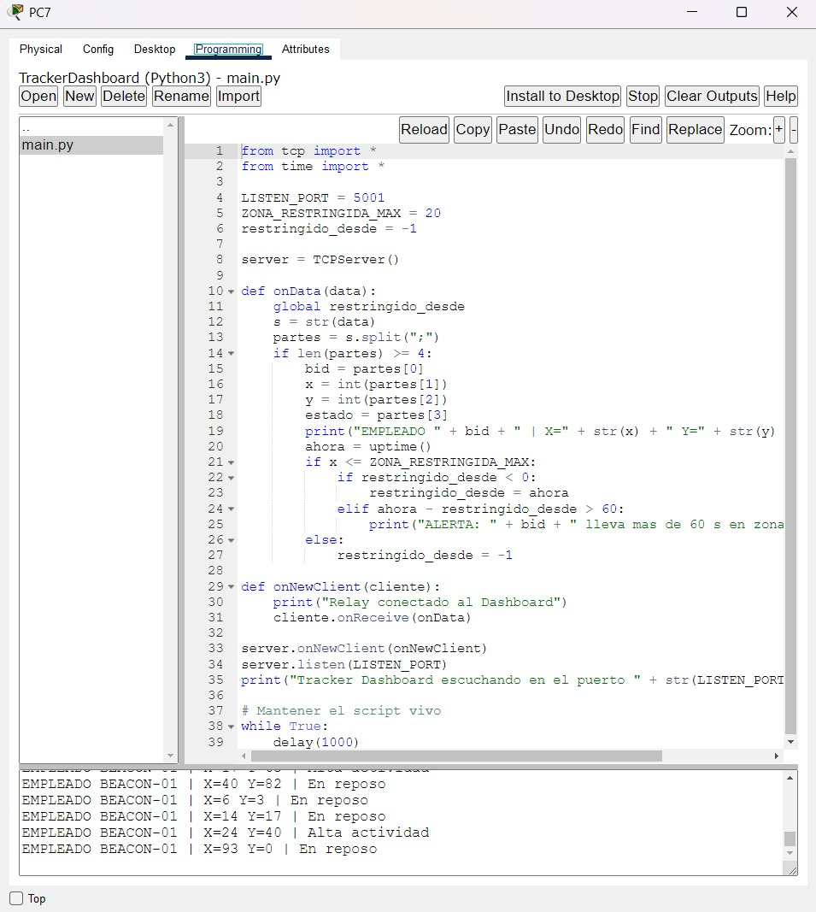

*Figura 21. Tracker Dashboard en PC7 (puerto 5001) recibiendo el ID, la posición X, Y y el estado de actividad del empleado BEACON-01.*

---

## 11. Pruebas y resultados

Ejecutamos una batería de pruebas de extremo a extremo. Cada fila se validó en el simulador.

| # | Prueba | Resultado |
|---|---|:---:|
| PR-01 | Enrutamiento IPv4 del núcleo WAN entre routers | Correcto |
| PR-02 | ICMPv6 local en la intranet Bogotá | Correcto |
| PR-03 | ICMPv6 local en la intranet Madrid | Correcto |
| PR-04 | ICMPv6 inter-sede por el túnel VPN | Correcto |
| PR-05 | SA de IPsec activas (show crypto ipsec sa) | Correcto |
| PR-06 | Resolución DNS de jujusa.net | Correcto |
| PR-07 | HTTPS a jujusa.net desde la VLAN interna | Correcto |
| PR-08 | Bloqueo de HTTP desde la VLAN 10 de Bogotá | Correcto |
| PR-09 | HTTP permitido desde la VLAN 20 de Bogotá | Correcto |
| PR-10 | Bloqueo de HTTPS desde la VLAN 20 de Bogotá | Correcto |
| PR-11 | Bloqueo de HTTPS desde la VLAN 20 de Madrid | Correcto |
| PR-12 | Agentes SNMP activos en la infraestructura | Correcto |
| PR-13 | Convergencia del enrutamiento dinámico IPv6 con redistribución | Correcto |
| PR-14 | SNMP denegado desde la VLAN de invitados y permitido desde la interna | Correcto |
| PR-15 | Redistribución OSPFv2 y EIGRP AS 7 en el núcleo IPv4 del ISP (rutas D y O en ISP_BOG) | Correcto |
| PR-16 | SNMP get y set desde PC5 hacia SW4 (192.168.10.2) por la red de gestión IPv4 | Correcto |

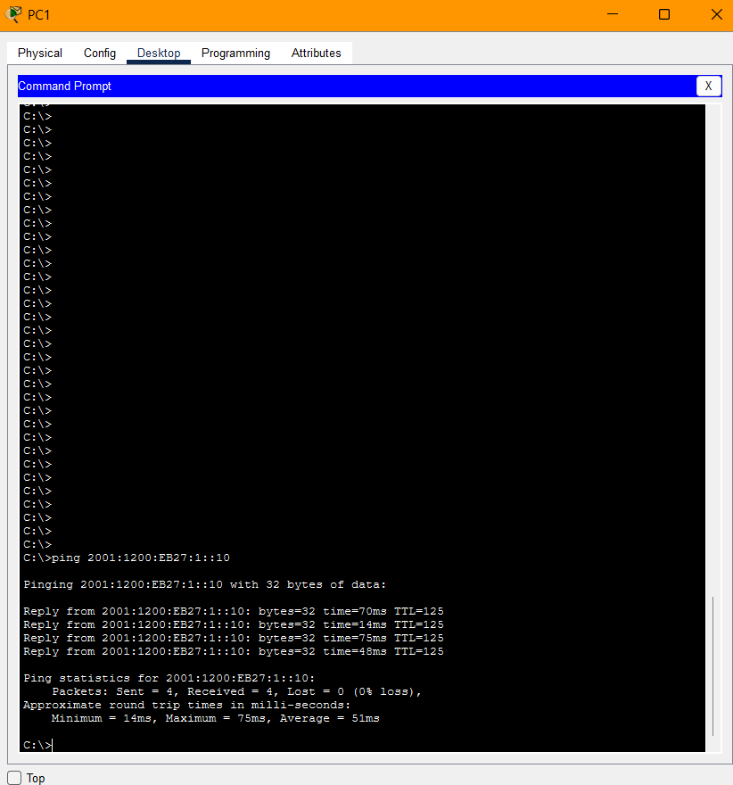

*Figura 22. Ping IPv6 de PC1 (Bogotá) a PC5 (2001:1200:EB27:1::10) a través del túnel IPsec: 4 de 4 respuestas, 0 % de pérdida.*

---

## 12. Respuestas a las preguntas guía del procedimiento

**¿Qué método de asignación de direcciones se configura y dónde?**
Los hosts usan direccionamiento IPv6 estático con su gateway y su servidor DNS. El direccionamiento estático da control total sobre servidores y equipos de infraestructura, donde una dirección fija es deseable. Para un despliegue a mayor escala, la asignación automática con DHCPv6 (RFC 8415) [11] o con autoconfiguración SLAAC (RFC 4862) [14] reduce el trabajo manual.

**¿En qué interfaces se configuran las troncales y con qué estándar?**
En los enlaces entre switches y en el enlace de cada switch hacia el router o el 3650. El estándar es IEEE 802.1Q [2], con VLAN nativa 99.

**¿Dónde se configuran OSPF o EIGRP y dónde la redistribución?**
EIGRP para IPv6 va en R1_BOG (subinterfaces LAN, enlace a la DMZ y el túnel) y en R2_ESP (el túnel). OSPFv3 va en el enlace entre R2_ESP y la MLSW y en las SVIs de la MLSW. La redistribución va en R2_ESP, que une los dos dominios y reparte las rutas en ambos sentidos. No se usa RIP. En IPv4, el núcleo del ISP corre OSPFv2 (ISP_BOG, ISP_FL, ISP_ESP) y EIGRP AS 7 (ISP_BOG, ISP_NET, ISP_ESP), con redistribución mutua en ISP_BOG e ISP_ESP.

**¿Dónde se ubican las ACLs?**
Cerca del origen del tráfico. En Bogotá entran en las subinterfaces de R1_BOG. En Madrid entran en las SVIs del 3650. Esto descarta el tráfico no permitido antes de que cruce la red [12].

**¿Qué servicio de migración permite el acceso IPv6 a través de Internet IPv4?**
Un túnel 6in4, que encapsula IPv6 dentro de IPv4 (RFC 4213) [4]. Para la comunicación segura entre intranets se añade IPsec con IKEv1 y ESP (RFC 2409, RFC 4303) [5], [6].

**¿Qué servicio deniega SNMP a las demás VLANs?**
Una lista de control de acceso. En IPv6, la regla niega el tráfico SNMP (UDP 161) que nace en la VLAN de invitados y deja pasar el de la VLAN interna; entra en las subinterfaces de Bogotá y en las SVIs de Madrid. En la red de gestión IPv4 de Madrid, la ACL extendida `SNMP-GUEST-MAD` cumple la misma función entrante en la SVI Vlan20 del 3650.

---

## 13. Retos y soluciones

Clasificamos cada problema según la capa del modelo TCP/IP donde se originó, porque eso definió la herramienta de diagnóstico: `show vlan brief` y `show interfaces trunk` para la capa de enlace, tablas de rutas y vecindades para la capa de internet, contadores de ACL y pruebas por puerto para la capa de transporte, y el comportamiento de los servicios para la capa de aplicación.

| Reto | Capa TCP/IP | Síntoma | Herramienta de diagnóstico |
|---|---|---|---|
| 1. ACLs sin efecto | Transporte (filtro por puerto TCP/UDP) | HTTP pasaba donde debía bloquearse | `show ipv6 access-list`, navegador |
| 2. Puertos y VLANs mal configurados | Enlace (acceso a la red) | PCs sin llegar a su gateway con IP correcta | `show vlan brief`, `show interfaces trunk` |
| 3. Web desde Madrid por el túnel | Internet (MTU) con solución en transporte (MSS) | Ping y DNS sí, página web no | Ping extendido con distintos tamaños |
| 4. Vecindad OSPFv3 en 2WAY | Internet (enrutamiento) | Madrid sin rutas de Bogotá | `show ipv6 ospf neighbor`, `show ipv6 route` |
| 5. SNMP sin respuesta | Aplicación (agente SNMP y gestor) | MIB Browser con *timeout* | Ping al agente, prueba con otro agente |

**Reto 1. ACLs de seguridad sin efecto (capa de transporte).**
La ACL web de Bogotá existía pero no estaba aplicada a ninguna interfaz, y Madrid no tenía ninguna. El filtrado por puerto TCP, que es un control de capa de transporte, no se cumplía. Aplicamos la ACL de Bogotá en las subinterfaces de R1_BOG y creamos y aplicamos la ACL de Madrid en las SVIs del 3650. Lo verificamos con los contadores de aciertos.

**Reto 2. Puertos y VLANs mal configurados (capa de enlace).**
Varios puertos de PC estaban como troncales y dos equipos estaban en una VLAN que no correspondía a su dirección, lo que los dejaba sin conectividad. La dirección IP era correcta, pero sin la VLAN correcta la trama no llegaba al gateway, así que el fallo estaba debajo de la capa de internet. A un switch le faltaba la VLAN 99 en su base de datos. Pasamos los puertos de PC a modo acceso en su VLAN correcta, movimos las impresoras a la VLAN 40, creamos la VLAN 99 donde faltaba y dejamos el enlace entre los switches de Madrid como troncal con nativa 99.

**Reto 3. Carga web desde Madrid a través del túnel (capas de internet y transporte).**
Los hosts de Madrid hacían ping y resolvían DNS, pero la página web no cargaba completa. La causa es el tamaño de los paquetes. El túnel IPsec sobre 6in4 sobre enlaces seriales de 1500 bytes transporta paquetes de hasta cerca de 1476 bytes. Un ping extendido de 1400 bytes pasa y uno de 1500 falla. El servidor envía segmentos grandes que no caben. La solución correcta es ajustar el MSS de TCP o la MTU del troncal de Internet. En nuestra topología los routers del ISP quedaron fuera de alcance administrativo, así que documentamos la causa y su efecto. Las pruebas de la sección 11 no dependen de este punto, porque el acceso web obligatorio desde Madrid es de bloqueo y se cumple a nivel de ACL. La causa está en la capa de internet (MTU del camino) y la solución recomendada en la capa de transporte (MSS de TCP), lo que explica por qué ping y DNS, con paquetes pequeños, sí funcionaban.

**Reto 4. Vecindad OSPFv3 detenida en 2WAY (capa de internet).**
Al activar OSPFv3 entre R2_ESP y el 3650, la vecindad se quedaba en 2WAY y la MLSW no recibía las rutas de Bogotá ni de la DMZ. En un segmento Ethernet OSPF elige un DR y un BDR, y en ese estado la adyacencia no siempre progresa. Como el enlace solo tiene dos routers, lo configuramos como punto a punto (`ipv6 ospf network point-to-point`) en ambos extremos. La vecindad pasó a FULL y la MLSW instaló las rutas OE2.

**Reto 5. SNMP sin respuesta desde el MIB Browser (capa de aplicación).**
El MIB Browser de un PC interno respondía *SNMP request timed out* al hacer get. Primero descartamos las capas inferiores: los PCs llegaban por ping a los equipos. Encontramos dos causas de capa de aplicación. La primera, el MIB Browser de Packet Tracer no gestiona agentes por IPv6, y la intranet solo tenía IPv6. La resolvimos con la red de gestión IPv4 de la sección 3.6. La segunda, el agente SNMP del 3650 no respondió al MIB Browser aunque tenía IPv4 y comunidades. Probamos con el switch de acceso SW4_Intranet (2960) en `192.168.10.2`, que sí respondió a get y set. Desde entonces SW4 es el agente gestionado y el 3650 sigue como gateway y punto de control de la ACL.

---

## 14. Uso de inteligencia artificial

El equipo consultó un asistente de IA para resolver dudas técnicas puntuales y de redacción. Usamos las respuestas como punto de partida y las validamos en el simulador antes de aplicarlas. A continuación están las interacciones principales y la forma en que comprobamos cada respuesta.

**Asistente consultado:** Claude (Anthropic) y ChatGPT (OpenAI).

**Prompt 1.**
"Necesito unir dos intranets IPv6 a través de una red que solo tiene IPv4, usando dos routers Cisco 2811 en Packet Tracer. ¿Qué mecanismo de transición me recomiendas y cómo configuro el túnel?"
La IA recomendó un túnel configurado 6in4 con `tunnel mode ipv6ip`. Validamos la respuesta levantando el túnel y comprobando con `show ipv6 interface brief` que la interfaz Tunnel0 quedaba up/up, y con un ping IPv6 entre los extremos del túnel.

**Prompt 2.**
"¿Cómo protejo ese túnel con IPsec usando IKEv1 en IOS? Dame la política ISAKMP, la clave precompartida, el transform-set y el crypto map, y dónde aplicarlo."
La IA entregó la secuencia de `crypto isakmp policy`, `crypto ipsec transform-set` y `crypto map`, y señaló que el crypto map va en la interfaz serial, no en el túnel. Validamos con `show crypto isakmp sa` y `show crypto ipsec sa`, confirmando que las SA quedaban activas y que los contadores de cifrado subían al generar tráfico entre sedes.

**Prompt 3.**
"Quiero una ACL IPv6 que permita HTTPS y bloquee HTTP hacia un servidor para una VLAN, y lo contrario para otra VLAN. ¿Cómo la escribo y en qué interfaz la aplico?"
La IA explicó el filtrado por puerto con `eq 443` y `eq www`, el orden de las reglas y la ubicación entrante cerca del origen. Validamos leyendo los contadores de aciertos con `show ipv6 access-list` y navegando desde los PCs para confirmar qué protocolo pasaba y cuál no.

**Prompt 4.**
"En Packet Tracer, ¿cómo habilito el switch 3650 como switch de capa 3 con SVIs y enrutamiento entre VLANs en IPv6?"
La IA indicó `ip routing`, `ipv6 unicast-routing` y una SVI por VLAN con su dirección. Validamos con `show ipv6 interface brief`, viendo las SVIs up/up, y con pings entre hosts de VLANs distintas de Madrid.

**Prompt 5.**
"Configuré la VLAN nativa 99 en los troncales, pero un switch no tiene esa VLAN en la base de datos. ¿Eso causa problemas y cómo lo corrijo?"
La IA explicó que la falta de la VLAN nativa en la base de datos genera inconsistencias y advertencias, y que la solución es crear la VLAN en el switch. Validamos con `show vlan brief` y `show interfaces trunk`, confirmando la VLAN 99 presente y la nativa coherente en los dos extremos.

**Prompt 6.**
"Desde Madrid hago ping al servidor web y resuelve el DNS, pero la página no carga a través del túnel. ¿Qué puede estar pasando?"
La IA señaló un problema de MTU y MSS por la sobrecarga de IPsec sobre el túnel. Validamos con un ping extendido de distintos tamaños. Un paquete de 1400 bytes pasó y uno de 1500 falló, lo que confirmó el límite del túnel.

**Prompt 7.**
"¿Cómo cito un RFC y un estándar IEEE en formato IEEE?"
La IA mostró el patrón con autor, título, número de documento y fecha para los RFC, y con título del estándar, número y año para IEEE. Lo contrastamos con la guía de estilo IEEE antes de armar la sección de referencias.

**Prompt 8.**
"Quiero EIGRP para IPv6 entre dos routers por un túnel y OSPFv3 en el otro tramo, con redistribución mutua en el router de borde. ¿Cómo lo configuro y por qué mi vecindad OSPFv3 se queda en 2WAY en un enlace de dos routers?"
La IA describió la redistribución en los dos sentidos en el router frontera y explicó que el 2WAY en un enlace de dos routers se resuelve con tipo de red punto a punto, que evita la elección de DR. Validamos con `show ipv6 ospf neighbor`, que pasó a FULL, y con `show ipv6 route`, confirmando las rutas EIGRP externas en un extremo y las OSPF externas en el otro. Notamos que la redistribución de EIGRP en OSPF no generaba LSAs externos cuando usamos `metric-type 1`, y sí lo hizo con la métrica simple, así que ajustamos el comando.

**Prompt 9.**
"El MIB Browser de PC5 me aparece timeout al hacer get de sysName al switch de Madrid."
La IA explicó que el MIB Browser de Packet Tracer gestiona por IPv4 y que la intranet de Madrid solo tenía IPv6, y propuso una red de gestión IPv4 en doble pila con una ACL que niega UDP 161 a los invitados. Validamos con ping desde PC5 y PC6 hacia las nuevas direcciones. Como el get al 3650 siguió dando timeout, probamos el switch SW4 en `192.168.10.2`, que sí respondió. Confirmamos el get y el set en el MIB Browser y el intercambio GetRequest y GetResponse en el modo simulación.

Criterio de validación general. Ninguna respuesta se dio por buena sin probarla. Cada configuración sugerida se cargó en el laboratorio y se verificó con comandos `show`, con pings y con el modo simulación. Cuando una respuesta no coincidía con el comportamiento observado, se descartó o se ajustó.

---

## 15. Roles y contribuciones

**Juan José Campos Valderrama.** Configuración de la nube de Internet (routers ISP) y de la DMZ. Montaje de los enlaces WAN y del direccionamiento IPv4. Configuración del servidor Web y del portal personalizado.

**Jusselth Habid Chica Rodríguez.** Direccionamiento IPv6 de las intranets. Configuración de VLANs, troncales 802.1Q y enrutamiento inter-VLAN en Bogotá y Madrid. Configuración y verificación del túnel 6in4 con IPsec. Auditoría y corrección de capa 2.

**Santiago Álvarez Maffiold.** Configuración del servidor DNS y de los registros AAAA. Diseño y aplicación de las ACLs IPv6. Configuración de SNMP. Desarrollo de la aplicación Employee Tracker y pruebas de flujo.

**Distribución de la presentación en el video.** Para equilibrar los tiempos, la exposición se repartió así. Jusselth presenta la topología, el diseño del direccionamiento, las VLANs, el enrutamiento inter-VLAN y el enrutamiento dinámico IPv6. Juan José presenta el núcleo WAN IPv4, la migración con el túnel 6in4, la VPN IPsec, la DMZ, el DNS y el servidor Web. Santiago presenta las ACLs, la gestión SNMP, el Employee Tracker y las conclusiones. Cada integrante puede responder sobre los temas de los demás.

---

## 16. Conclusiones y recomendaciones

**Conclusiones.**

La doble pila funciona. Las intranets IPv6 se comunican a través de una red IPv4 mediante un túnel 6in4, y el tráfico viaja cifrado con IPsec. El control de acceso por protocolo se cumple con ACLs IPv6 ubicadas cerca del origen y se comprueba con los contadores de aciertos. La segmentación con VLANs y troncales 802.1Q aísla a los usuarios internos de los invitados.

El trabajo de auditoría mostró que una ACL escrita no sirve si no se aplica, y que un error de VLAN deja un equipo sin red aunque su dirección sea correcta. La verificación con comandos `show` y con el modo simulación fue tan importante como la configuración.

**Recomendaciones.**

Ajustar el MSS de TCP o la MTU del troncal de Internet para que el servicio web cargue desde Madrid a través del túnel. Migrar SNMP a la versión 3 para autenticar y cifrar la gestión. Etiquetar las rutas en la redistribución y filtrarlas para evitar bucles si en el futuro se añade una segunda frontera entre EIGRP y OSPF. Asignar las direcciones de los hosts con DHCPv6 cuando el número de equipos crezca.

---

## 17. Referencias

[1] S. Deering y R. Hinden, "Internet Protocol, Version 6 (IPv6) Specification," IETF, RFC 8200, jul. 2017.

[2] IEEE Standard for Local and Metropolitan Area Networks. Bridges and Bridged Networks, IEEE Std 802.1Q-2018, 2018.

[3] S. Thomson, C. Huitema, V. Ksinant y M. Souissi, "DNS Extensions to Support IP Version 6," IETF, RFC 3596, oct. 2003.

[4] E. Nordmark y R. Gilligan, "Basic Transition Mechanisms for IPv6 Hosts and Routers," IETF, RFC 4213, oct. 2005.

[5] D. Harkins y D. Carrel, "The Internet Key Exchange (IKE)," IETF, RFC 2409, nov. 1998.

[6] S. Kent, "IP Encapsulating Security Payload (ESP)," IETF, RFC 4303, dic. 2005.

[7] S. Kent y K. Seo, "Security Architecture for the Internet Protocol," IETF, RFC 4301, dic. 2005.

[8] P. Mockapetris, "Domain Names. Implementation and Specification," IETF, RFC 1035, nov. 1987.

[9] J. Case, M. Fedor, M. Schoffstall y J. Davin, "A Simple Network Management Protocol (SNMP)," IETF, RFC 1157, may. 1990.

[10] R. Presuhn, "Version 2 of the Protocol Operations for the Simple Network Management Protocol (SNMP)," IETF, RFC 3416, dic. 2002.

[11] T. Mrugalski et al., "Dynamic Host Configuration Protocol for IPv6 (DHCPv6)," IETF, RFC 8415, nov. 2018.

[12] IEEE Standard for Ethernet, IEEE Std 802.3-2018, 2018.

[13] J. F. Kurose y K. W. Ross, Computer Networking: A Top-Down Approach, 8.ª ed. Hoboken, NJ, EE. UU.: Pearson, 2021.

[14] S. Thomson, T. Narten y T. Jinmei, "IPv6 Stateless Address Autoconfiguration," IETF, RFC 4862, sep. 2007.

[15] A. S. Tanenbaum y D. J. Wetherall, Computer Networks, 5.ª ed. Boston, MA, EE. UU.: Pearson Prentice Hall, 2011.

[16] Cisco Systems, "IPv6 Configuration Guide, Cisco IOS Release 15M&T," Cisco Systems, San José, CA, EE. UU., 2018. [En línea]. Disponible en: https://www.cisco.com/c/en/us/td/docs/ios-xml/ios/ipv6/configuration/15-mt/ipv6-15-mt-book.html

[17] D. Savage, J. Ng, S. Moore, D. Slice, P. Paluch y R. White, "Cisco's Enhanced Interior Gateway Routing Protocol (EIGRP)," IETF, RFC 7868, may. 2016.

[18] R. Coltun, D. Ferguson, J. Moy y A. Lindem, "OSPF for IPv6," IETF, RFC 5340, jul. 2008.
